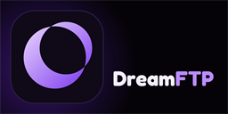

<p align="center">
  
</p>

<h1 align="center">DreamFTP</h1>

<p align="center">FTP server, file browser and CIA installer for your 3DS</p>

DreamFTP is a purple-and-black fork of [Cement](https://github.com/Synaelle/cement)
by Synaelle: the same fast FTP server and CIA installer, with its own look, name
and icon. Everything below that is not the look comes from Cement.

## Use it

Build `DreamFTP.cia` or `DreamFTP.3dsx` (see below) and install it with FBI.
There are no releases of this fork yet, so there is no QR code.

Open it and connect to the address on the top screen (like `192.168.1.10:5000`)
with any FTP client, or with [Baguette](https://github.com/Synaelle/baguette), the
PC app made for it. Baguette shows progress and the battery, installs CIAs from
the PC, sends many small files faster and keeps its colour in sync with DreamFTP.

## On the 3DS

L and R switch tabs. Recent lists the CIAs you sent and those in `/`, `/cia`,
`/cias` and `/fbi`. Browse opens any folder and shows PNG, JPEG and BMP images.
Settings holds the FTP login, the looks, auto off and updates, and the top screen
explains each one.

A installs the selected CIA and deletes the file afterwards. A reinstall, a
downgrade or a system title needs A twice, and a PC can't install system titles.
X deletes a file or folder when pressed twice, except the important 3DS files
while their protection is on.

A `.cia` sent over FTP installs by itself when the upload finishes, then the file
is deleted. Reinstalls, downgrades and system titles still ask for A on the
bottom screen. To keep a CIA on the card without installing it, give it another
extension (`.cia.bak`) and rename it back later.

With no login set, anyone on your Wi-Fi can connect. Only a salted hash of the
password is kept.

## The look

Three looks in Settings, all on near-black: **Dream** (purple), **Teal** (graphite
and teal) and **Sharp** (purple, Hanken Grotesk, square corners). The Dream look
follows the Colour row, or `SITE COLOR` from Baguette, so every accent recolours
the whole app.

`tools/make-art.ps1` redraws `meta/icon.png` and `meta/banner.png` (the crescent)
on Windows.

## Build

On Linux or WSL, with devkitPro (or Docker), `makerom`, `bannertool` and libclang:

```sh
rustup toolchain install nightly-2026-11-09 -c rust-src
cargo install --locked cargo-3ds --version 0.1.5
./build.sh
```

`./build.sh fast` builds quicker to try a change.

## Credits

The app, its layout and the FTP and installer code are Synaelle's Cement. The
fonts are [Fredoka](https://github.com/hafontia/Fredoka-One),
[Nunito](https://github.com/googlefonts/nunito) and
[Hanken Grotesk](https://github.com/marcologous/hanken-grotesk) (SIL Open Font
License), and the button glyphs are Kenney's
[Input Prompts](https://kenney.nl/assets/input-prompts) (CC0).

## License

AGPL-3.0 or later, see [LICENSE](LICENSE). The CIA installer follows
[FBI](https://github.com/Steveice10/FBI) (MIT), see [NOTICE](NOTICE).
