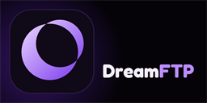
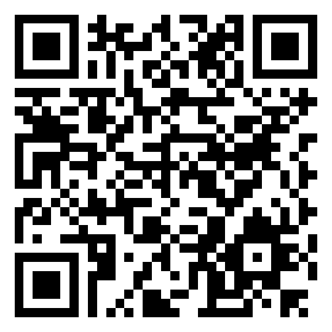

<p align="center">
  <b>Português (BR)</b> · <a href="README.md">English</a>
</p>

<p align="center">
  
</p>

<h1 align="center">DreamFTP</h1>

<p align="center">Servidor FTP, navegador de arquivos e instalador de CIA para o 3DS</p>

> [!NOTE]
> DreamFTP é um fork do [Cement](https://github.com/Synaelle/cement), do
> Synaelle. A diferença: **um `.cia` enviado por FTP instala sozinho** quando o
> upload termina, e o arquivo é apagado. O interruptor fica nas configurações.

## O que muda em relação ao Cement

- **Instala no upload.** Mande um `.cia` por FTP e ele instala quando o envio
  termina; o arquivo some. Settings → "Install CIA over FTP" desliga isso, e aí
  o upload espera A em Recent.
- **Visual roxo e preto.** Temas Dream, Teal e Sharp, com a meia lua na tela de
  cima.
- **Nome, ícone e banner novos.**
- Todo o resto — servidor FTP, navegador, instalador, comandos SITE e suporte ao
  Baguette — é trabalho do Cement.

## Instalar

Escaneie no FBI (Remote Install → Scan QR Code), ou baixe o `DreamFTP.cia` em
[Releases](../../releases/latest) e instale pelo cartão SD.



O `.3dsx` também está em Releases, para o Homebrew Launcher.

## Usar

Abra e conecte no endereço da tela de cima (tipo `192.168.1.10:5000`) com
qualquer cliente FTP, ou com o
[Baguette](https://github.com/Synaelle/baguette), o app de PC feito para ele. O
Baguette mostra progresso e bateria, instala CIAs pelo PC, manda muitos arquivos
pequenos mais rápido e mantém a cor sincronizada com o DreamFTP.

## No 3DS

L e R trocam de aba. Recent lista os CIAs que você mandou e os que estão em `/`,
`/cia`, `/cias` e `/fbi`. Browse abre qualquer pasta e mostra imagens PNG, JPEG e
BMP. Settings guarda o login do FTP, os visuais, desligar sozinho e updates, e a
tela de cima explica cada linha.

A instala o CIA selecionado e apaga o arquivo depois. Reinstalar, downgrade ou
título de sistema pede A duas vezes, e o PC não instala título de sistema. X
apaga arquivo ou pasta quando apertado duas vezes, exceto os arquivos importantes
do 3DS enquanto a proteção estiver ligada.

Um `.cia` enviado por FTP instala sozinho quando o upload termina, e o arquivo é
apagado. Settings → "Install CIA over FTP" desliga isso, e o arquivo fica no
cartão esperando A em Recent. Reinstalar, downgrade e título de sistema sempre
pedem A na tela de baixo. Para guardar um CIA sem instalar, use outra extensão
(`.cia.bak`) e renomeie depois.

## O visual

Três visuais em Settings, todos sobre quase-preto: **Dream** (roxo), **Teal**
(grafite e teal) e **Sharp** (roxo, Hanken Grotesk, cantos retos). O Dream segue
a linha Colour, ou o `SITE COLOR` do Baguette, então cada cor de destaque recolore
o app inteiro.

`tools/make-art.ps1` redesenha `meta/icon.png` e `meta/banner.png` (a meia lua) no
Windows. `tools/serve-cia.mjs` serve um `.cia` na rede local, para o Remote
Install do FBI.

## Compilar

No Linux ou WSL, com devkitPro (ou Docker), `makerom`, `bannertool` e libclang:

```sh
rustup toolchain install nightly-2026-11-09 -c rust-src
cargo install --locked cargo-3ds --version 0.1.5
./build.sh
```

`./build.sh fast` compila mais rápido para testar uma mudança. O GitHub Actions
gera os dois arquivos também (Actions → build → Run workflow).

## Créditos

O app, o layout e o código de FTP e instalação são o Cement, do Synaelle. As
fontes são [Fredoka](https://github.com/hafontia/Fredoka-One),
[Nunito](https://github.com/googlefonts/nunito) e
[Hanken Grotesk](https://github.com/marcologous/hanken-grotesk) (SIL Open Font
License), e os glifos de botão são do Kenney's
[Input Prompts](https://kenney.nl/assets/input-prompts) (CC0).

## Licença

AGPL-3.0 ou posterior, veja [LICENSE](LICENSE). O instalador de CIA segue o
[FBI](https://github.com/Steveice10/FBI) (MIT), veja [NOTICE](NOTICE).
